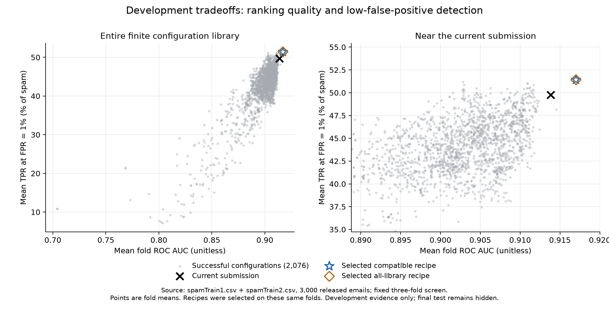

# Broad spam-classifier search

Retain the current submission: the compatible screen-selected recipe fails the prespecified promotion gate.

This report records the analysis gate. A passing candidate still requires an exact submission implementation and separate interface/parity verification; this script does not change `classifySpam.py`.

## Scope and frozen procedure

- **2,076 unique constructor-expanded configurations**, from 2,116 serialized specifications; 40 default aliases were deduplicated. The menu has 47 source/family labels; preprocessing variants are not separate fundamental algorithms.
- All **3,000 released emails** are development data. The screen uses three folds. Nested validation repeats the full 2,076-configuration search inside each of 3 outer training partitions, with three inner folds per partition.
- The four search phases contain **24,912 planned configuration/fold fit slots**; 24,912 successful fold results were recorded. There were also 13 selected-member outer refit attempts and 100 member refit attempts across 25 repeated-check folds. The current three-component ensemble counts as one configuration per fit here; this is not a count of every internal estimator fit.
- All learned imputation, scaling, binning, feature selection, and model fitting use the training partition only. Raw decision margins are retained for ranking-only classifiers.
- Selection requires mean fold AUC at least the current submission's, then maximizes `mean AUC + 0.05 × mean TPR`. This is a research heuristic, not the instructor's grade formula.
- Probability-model pools have at most 24 members and two per family. The finite blend menu covers all declared pair weights, all declared triple weight permutations, and 5,000 seeded sparse Dirichlet draws, each in probability and logit space. All singletons are also considered. Stacking was not evaluated.
- Compatible primary search: **30,884 screen recipe evaluations**, including 1,932 singletons and 28,952 blends; the nested selectors add 92,652 recipe evaluations. Menus overlap across procedures and folds; these totals are not distinct mathematical algorithms.
- All-library benchmark: **31,028 screen recipe evaluations**, including 2,076 singletons and 28,952 blends; the nested selectors add 93,084 recipe evaluations. Menus overlap across procedures and folds; these totals are not distinct mathematical algorithms.

The initial 250-configuration nested pilot was expanded to the complete library after a runtime-only check, before inspecting any performance metrics. Data, model specifications, split IDs, selector, and timeout limits stayed fixed. The pilot and expansion provenance are retained in [protocol_pilot.json](protocol_pilot.json) and [protocol.json](protocol.json).

## Results and promotion gate

Screen baseline: **AUC 0.913821599693; TPR at 1% FPR 49.748743719%**.
The screen had **0** other successful configurations that exceeded the baseline on both mean metrics. These are exploratory comparisons on the same selection folds.

- Compatible selected recipe: **AUC 0.917008909442; TPR at 1% FPR 51.423785595%**.
- logit combination: 0.25 × advanced_bins (C=0.3, bins=12, missing=prior, presence=True, spacing=quantile; ID `52149895e26f72aa`); 0.25 × hist (impute=native, l2_regularization=0.1, learning_rate=0.05, max_iter=400, max_leaf_nodes=7, min_samples_leaf=10; ID `c7fd8218ac8820ea`); 0.5 × interactions (C=0.001, features=30, interaction_only=False; ID `b9777ff48789c022`).
- All-library selected recipe: **AUC 0.917008909442; TPR at 1% FPR 51.423785595%**.
- logit combination: 0.25 × advanced_bins (C=0.3, bins=12, missing=prior, presence=True, spacing=quantile; ID `52149895e26f72aa`); 0.25 × hist (impute=native, l2_regularization=0.1, learning_rate=0.05, max_iter=400, max_leaf_nodes=7, min_samples_leaf=10; ID `c7fd8218ac8820ea`); 0.5 × interactions (C=0.001, features=30, interaction_only=False; ID `b9777ff48789c022`).

Nested assessment evaluates the selection procedure, with a separately selected recipe in each outer fold. It does not evaluate one fixed recipe across all outer folds.

- Nested baseline: **AUC 0.908367974980; TPR at 1% FPR 52.261306533%**.
- Compatible selector: **AUC 0.911168522569; TPR at 1% FPR 50.418760469%**; change from baseline: AUC +0.002800548; TPR -1.842546 percentage points.
- All-library selector: **AUC 0.910977923950; TPR at 1% FPR 50.167504188%**; change from baseline: AUC +0.002609949; TPR -2.093802 percentage points.

The repeated check holds the screen-selected recipes fixed across 5 repetitions of five folds, seeds 17, 29, 47, 71, 101.
- Repeated-check baseline: **AUC 0.912360043275; TPR at 1% FPR 49.197848177%**.
- Compatible fixed recipe: **AUC 0.914750600405; TPR at 1% FPR 47.303189058%**. Change: AUC +0.002390557; TPR -1.894659 percentage points; both metrics improved in 1/5 repetition means.
- All-library fixed recipe: **AUC 0.914750600405; TPR at 1% FPR 47.303189058%**. Change: AUC +0.002390557; TPR -1.894659 percentage points; both metrics improved in 1/5 repetition means.

The promotion rule requires **both** mean metrics to improve in the repeated check, both to improve in at least four of five repetition means, and the compatible nested selector to improve both mean outer metrics.

- Repeated portion: **FAIL**.
- Compatible nested portion: **FAIL**.
- Combined analysis gate: **FAIL**.



## Coverage, failures, and warnings

- additional: **130 configurations** — adam_mlp (12), complement_nb (12), elastic_logistic (24), missingness_augmented_logistic (6), multinomial_nb (12), nu_svm (12), nystroem_rbf (8), polynomial_svm (24), random_fourier (8), regularized_qda (12).
- archive: **1,801 configurations** — adaboost (8), adaline (6), advanced_bins (292), baseline (1), bernoulli (1), binned (30), chi2_logistic (18), extra (14), forest (14), gb (58), hist (80), interactions (30), iterative_logistic (40), kernel_svm (56), knn (24), knn_binned (64), knn_hist (18), knn_logistic (561), knn_svm (48), lda (4), lda_projection (2), linear_svm (8), logistic (137), mlp (36), original (1), pca_logistic (3), pca_svm (3), perceptron (6), power (30), selected_logistic (3), spline (72), svm (125), tree (8).
- current: **1 configurations** — current_submission (1).
- external: **144 configurations** — catboost (48), lightgbm (48), xgboost (48).

Archived `baseline` means Gaussian naive Bayes; archived `original` is an older ensemble. `current:current_submission` is the actual leaderboard-winning submission.

- screen: 2,076/2,076 configurations completed all folds; 0 failed; 58 recorded non-FutureWarning notices.
- nested_0: 2,076/2,076 configurations completed all folds; 0 failed; 54 recorded non-FutureWarning notices.
- nested_1: 2,076/2,076 configurations completed all folds; 0 failed; 55 recorded non-FutureWarning notices.
- nested_2: 2,076/2,076 configurations completed all folds; 0 failed; 53 recorded non-FutureWarning notices.

Most frequent screen warnings (number of configuration records):
- 40: [IterativeImputer] Early stopping criterion not reached.
- 13: lbfgs failed to converge after 3000 iteration(s) (status=1): STOP: TOTAL NO. OF ITERATIONS REACHED LIMIT  Increase the number of iterations to improve the convergence (max_iter=3000). You might also want to scale the data as shown in:     https://scikit-learn.
- 4: lbfgs failed to converge after 1500 iteration(s) (status=1): STOP: TOTAL NO. OF ITERATIONS REACHED LIMIT  Increase the number of iterations to improve the convergence (max_iter=1500). You might also want to scale the data as shown in:     https://scikit-learn.
- 1: The max_iter was reached which means the coef_ did not converge

The limits were 45 seconds per estimator fit and 120 seconds per shared preprocessing operation. Warnings are retained rather than automatically treated as failed fits. Full failure messages and warnings are in the per-phase records and selection audit objects.

## Reproduction and environment

Use the saved protocol and task-local virtual environment. Source and data hashes are checked before fitting. Existing complete caches are resumed; do not reuse them after changing data, code, or specifications. `search.py init` intentionally refuses to overwrite the saved expanded protocol; run the existing phase definitions directly.

Versions: catboost 1.2.10; joblib 1.6.0; lightgbm 4.7.0; numpy 2.5.2; scikit-learn 1.9.0; scipy 1.18.1; threadpoolctl 3.6.0; xgboost 3.4.1.

On this Mac, the external boosting packages use the existing OpenMP library bundled with scikit-learn. The path below is machine-specific; no system library was replaced.

```bash
cd experiments/exhaustive_search
export DYLD_LIBRARY_PATH="/Library/Frameworks/Python.framework/Versions/3.12/lib/python3.12/site-packages/sklearn/.dylibs${DYLD_LIBRARY_PATH:+:$DYLD_LIBRARY_PATH}"
.venv/bin/python search.py screen --jobs 4
.venv/bin/python search.py nested_0 --jobs 4
.venv/bin/python search.py nested_1 --jobs 4
.venv/bin/python search.py nested_2 --jobs 4
.venv/bin/python assess_search.py --phase screen
.venv/bin/python assess_search.py --phase nested
.venv/bin/python -u -c 'import repeated_validation; repeated_validation.main(2)'
.venv/bin/python report_search.py
```

The compatible procedure uses the existing NumPy/SciPy/scikit-learn stack. CatBoost, XGBoost, and LightGBM were benchmarked separately because grader support for those dependencies is unknown. Their local availability does not make a submission using them grader-compatible.

## Interpretation and artifacts

- This is a large **finite** search, not exhaustion of all algorithms, feature representations, hyperparameters, or continuous ensemble weights.
- All released rows have been reused during historical development. The old 500-row confirmation partition is now development data. No result here is a fresh hidden-test estimate.
- Large-scale selection makes screen maxima optimistic. Nested validation repeats selection before accessing outer labels, but historical algorithm development still used these emails. See scikit-learn's [nested versus non-nested validation explanation](https://scikit-learn.org/stable/auto_examples/model_selection/plot_nested_cross_validation_iris.html).
- Repeated folds overlap and are not independent trials. Their variability and win counts are stability diagnostics, not confidence that a final leaderboard rank is guaranteed.
- At 1% FPR, a few high-scoring ham emails can move TPR materially. The final hidden test and its distribution remain unknown. The gate concerns both metrics and does not establish that no untested method could outperform the submission.

The complete audit is in [protocol.json](protocol.json), [screen family summaries](screen_family_summary.json), [screen selection](selection_screen.json), [nested assessment](nested_assessment.json), and [repeated results](repeated_results.json). Exact finite blend menus are saved as `recipes_<phase>_<procedure>.npz`; constituent specifications are in the protocol. The implementation is in [search.py](search.py), [ensemble_search.py](ensemble_search.py), [assess_search.py](assess_search.py), and [repeated_validation.py](repeated_validation.py).

The final submission decision is recorded in [decision.json](decision.json). The active `classifySpam.py` remains byte-for-byte identical to the frozen [baseline](baseline_classifier.py). A self-contained [experimental candidate](candidate_classifier.py) is retained for inspection, with [parity and interface checks](candidate_verification.json); it is not the active submission and did not pass the promotion gate. Raw per-fit caches remain in the local `results/` directory, which is excluded from version control.
